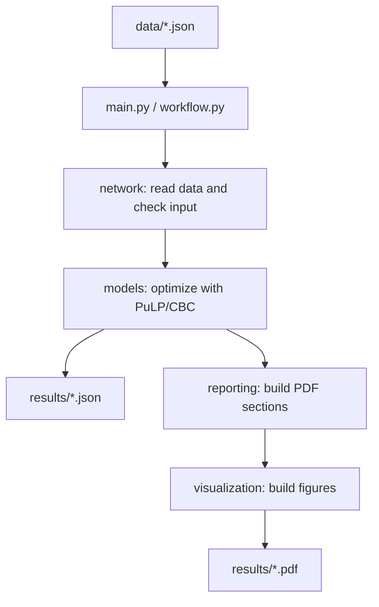

# Network Flow Optimizer

Select the traffic requests that earn the most revenue without exceeding network capacity. The project implements three mixed-integer optimization models using PuLP and CBC, then saves raw JSON and illustrated PDF reports.

## Goals

- Maximize the revenue of accepted traffic requests while respecting every link capacity.
- Compare single-path routing with traffic splitting across candidate paths.
- Determine when buying capacity or installing a new link improves net profit.
- Save complete routing and cost information as JSON and PDF results.

## Network assumptions

The network is a directed graph `G = (V, E)`. Every request has a source, a destination, a required bandwidth and an admission revenue. A request is accepted only when its entire bandwidth can be delivered; partial admission earns no revenue. Revenue maximization can select fewer requests than a request-count objective when their revenues differ.

| Symbol | Meaning |
|---|---|
| `V`, `E` | Network nodes and directed links. |
| `c_e` | Initial capacity of link `e`. |
| `h_d`, `b_d` | Required bandwidth and revenue of request `d`. |
| `x_d` | Binary admission decision for request `d`. |
| `alpha`, `beta` | Fixed new-link installation cost and cost per purchased capacity unit. |

Bandwidth and cost units must be consistent within each input. Dollar signs in reports are display notation.

## Quick start

Use Python **3.11 or newer**. From the parent folder:

```powershell
cd NetworkFlowOptimizer
python -m pip install -r requirements.txt
python main.py
```

This solves the six example networks and creates **10 JSON files and 10 PDF reports** in [results](results). Each model checks its input before solving. Input paths are resolved from the project directory, so running `python NetworkFlowOptimizer/main.py` from the parent folder also works.

| Command | Purpose |
|---|---|
| `python main.py --no-pdf` | Save raw JSON without loading PDF reporting. |
| `python main.py --no-plots` | Generate JSON and PDF tables without charts. |
| `python main.py --output-dir PATH` | Write case outputs to another directory; a relative path uses the current working directory. |

## Project structure

Each module has one responsibility. The solver, report and chart modules are separate so that changing a table or figure does not affect optimization.

```text
NetworkFlowOptimizer/
  main.py                  CLI for generating all example results
  workflow.py              Read, solve and save a single case
  requirements.txt          Direct dependencies
  data/                     Six example network configurations
  network/                  Graph data, traffic demands, JSON I/O, input validation
  models/                   Three solvers, shared candidate paths and flow extraction
  reporting/                PDF coordinator and separate report sections
  visualization/            Shared layout and separate route/utilization/expansion plots
  results/                  Current per-case JSON and PDF outputs
```



## Models and decision variables

| Model | Routing | Capacity decisions | Objective |
|---|---|---|---|
| Node-Link | One simple path for every accepted request; no splitting. | Existing capacities stay fixed. | Maximize admitted revenue. |
| Link-Path | A request may split across its candidate paths. | Existing capacities stay fixed. | Maximize admitted revenue. |
| Capacity expansion | Splittable routing over existing and optional links. | Buy capacity on expandable links and install optional links. | Maximize revenue minus capacity and installation costs. |

Node-Link adds binary link-use decisions `y_d,e`; flow conservation, degree bounds and increasing node order select one simple source-to-destination path without branches or cycles. Its objective is `sum(b_d * x_d)`, and each link must satisfy `sum(h_d * y_d,e) <= c_e`.

Link-Path adds a continuous fraction `lambda_d,p` for each candidate path. Fractions sum to `x_d`, and their bandwidth contributions on each link cannot exceed its capacity. Capacity design also introduces nonnegative capacity purchases and binary new-link installation decisions. Purchased capacity is bounded, fixed links cannot expand, and new capacity is available only if its link is installed. Its objective is admitted revenue minus all variable capacity costs and fixed installation costs.

**Candidate-set limit:** the two splittable models use up to `k_paths=3` shortest simple paths by hop count. Their `Optimal` status applies to those paths, not to every possible route in the graph. Node-Link uses the full existing topology. Equal-length candidate ordering follows the input edge insertion order.

To explore a larger candidate set from the project directory:

```python
from network import NetworkGraph
from models.link_path import solve_link_path_model

network = NetworkGraph.from_json_file("data/net_03.json")
solution = solve_link_path_model(network, k_paths=8)
print(solution["objective"])
```

## Example results

The JSON files contain complete routing allocations, including small fractions. Demand indices in both formats are **zero-based**.

| Network | Model | Accepted | Revenue | Capacity cost | Installation cost | Objective | Outputs |
|---|---|---:|---:|---:|---:|---:|---|
| net_01 | Node-Link | 3 / 4 | 240 | 0 | 0 | 240 | [JSON](results/net_01_node_link.json) · [PDF](results/net_01_node_link.pdf) |
| net_01 | Link-Path | 3 / 4 | 250 | 0 | 0 | 250 | [JSON](results/net_01_link_path.json) · [PDF](results/net_01_link_path.pdf) |
| net_02 | Node-Link | 6 / 6 | 830 | 0 | 0 | 830 | [JSON](results/net_02_node_link.json) · [PDF](results/net_02_node_link.pdf) |
| net_02 | Link-Path | 6 / 6 | 830 | 0 | 0 | 830 | [JSON](results/net_02_link_path.json) · [PDF](results/net_02_link_path.pdf) |
| net_03 | Node-Link | 1 / 3 | 80 | 0 | 0 | 80 | [JSON](results/net_03_node_link.json) · [PDF](results/net_03_node_link.pdf) |
| net_03 | Link-Path | 1 / 3 | 300 | 0 | 0 | 300 | [JSON](results/net_03_link_path.json) · [PDF](results/net_03_link_path.pdf) |
| net_04 | Node-Link | 4 / 5 | 1400 | 0 | 0 | 1400 | [JSON](results/net_04_node_link.json) · [PDF](results/net_04_node_link.pdf) |
| net_04 | Link-Path | 4 / 5 | 1650 | 0 | 0 | 1650 | [JSON](results/net_04_link_path.json) · [PDF](results/net_04_link_path.pdf) |
| net_05 | Capacity expansion | 5 / 8 | 790 | 60 | 0 | 730 | [JSON](results/net_05_capacity_expansion.json) · [PDF](results/net_05_capacity_expansion.pdf) |
| net_06_design | Capacity expansion | 2 / 2 | 70 | 11 | 10 | 49 | [JSON](results/net_06_design_capacity_expansion.json) · [PDF](results/net_06_design_capacity_expansion.pdf) |

The large difference on **net_03** illustrates the routing restriction. Its 30-unit request cannot fit on any single path, but the Link-Path model can carry it as two 15-unit allocations. On **net_05**, revenue of 790 minus a capacity cost of 60 gives net profit of 730.

The small **net_06_design** example exercises all three link types together:

- Expand existing `S -> A` from capacity 1 to 2, costing `1 × 2 = 2`.
- Keep existing `A -> T` fixed at capacity 2.
- Install new `S -> T`, pay 10 once, and buy capacity 3 for `3 × 3 = 9`.
- Admit both requests: `70 - 2 - 9 - 10 = 49` net profit.

## Input format

The [net_06_design input](data/net_06_design.json) is a complete example:

```json
{
  "nodes": ["S", "A", "T"],
  "edges": [["S", "A"], ["A", "T"]],
  "capacities": {"S->A": 1, "A->T": 2},
  "capacity_expansion": {
    "S->A": {"init_capacity": 1, "max_capacity": 4, "expansion_cost": 2}
  },
  "candidate_edges": {
    "S->T": {"max_capacity": 5, "expansion_cost": 3, "installation_cost": 10}
  },
  "demands": [
    {"source": "S", "target": "T", "bandwidth": 3, "revenue": 40},
    {"source": "S", "target": "T", "bandwidth": 2, "revenue": 30}
  ]
}
```

| Link set | JSON representation | Behavior |
|---|---|---|
| E1: expandable existing | In `edges` and `capacity_expansion`. | Expansion is bounded by `max_capacity - init_capacity`; each purchased unit costs `expansion_cost`. |
| E2: optional new | Only in `candidate_edges`. | Initial capacity is zero. A binary installation decision enables up to `max_capacity`; installation is paid once. |
| E3: fixed existing | In `edges`, without an expansion record. | Capacity cannot change. |

`init_capacity` must agree with the existing capacity. Optional `node_positions` map node names to `[x, y]` coordinates; otherwise figures use an automatic layout. Capacities and costs must be finite and nonnegative. Demand bandwidth must be positive; demand endpoints must exist and differ. Self-links are not supported. Capacity records must refer to existing links, and conflicting initial-capacity records are rejected.

Input costs may differ by link. Equal `installation_cost` values represent the common `alpha`, and equal `expansion_cost` values represent `beta`. The fixed-topology models cannot use `candidate_edges`. The CLI runs both models on inputs without design records, and the capacity model on inputs that contain `capacity_expansion` or `candidate_edges` records.

## Reading the raw output

| Field | Meaning |
|---|---|
| `status`, `objective`, `total_revenue` | Solver status, optimized value and admitted revenue. |
| `accepted_demands`, `rejected_demands` | Complete partition of the request indices. |
| `paths_used` | Every used path, its `flow_fraction` and absolute `flow_amount`. |
| `paths` | Representative path for each accepted request; use `paths_used` for all split routes. |
| `edge_utilization` | Complete link flow, available capacity and utilization percentage, including idle links. |
| `capacity_expansions`, `installed_edges` | Purchased capacities and installed optional links in the design model. |
| `total_expansion_cost`, `total_installation_cost`, `total_cost`, `net_profit` | Variable capacity cost, fixed installation cost, their sum and revenue minus that sum. |

JSON edge keys use `source->target`; paths contain ordered `[source, target]` pairs. The `bandwidth` entry inside a path allocation is an alias for `flow_amount`. Design-specific fields appear only in capacity-model results.

PDF reports include the numerical summary, accepted/rejected requests, complete path allocations, expansion costs, the 12 most utilized links and route/flow figures. JSON retains **all** links, including those omitted from that top-12 table.

## Initial input checks

Before solving, each model checks that link capacities and costs are finite and nonnegative, demand bandwidth is positive, and request endpoints exist and differ. Self-links, duplicate edges, capacity records for nonexistent links, inconsistent initial capacities and maximum capacities below initial capacities are rejected. The model also requires a positive candidate-path count.

If the solver does not return an optimal solution, the program reports an error instead of saving it as a successful result.
